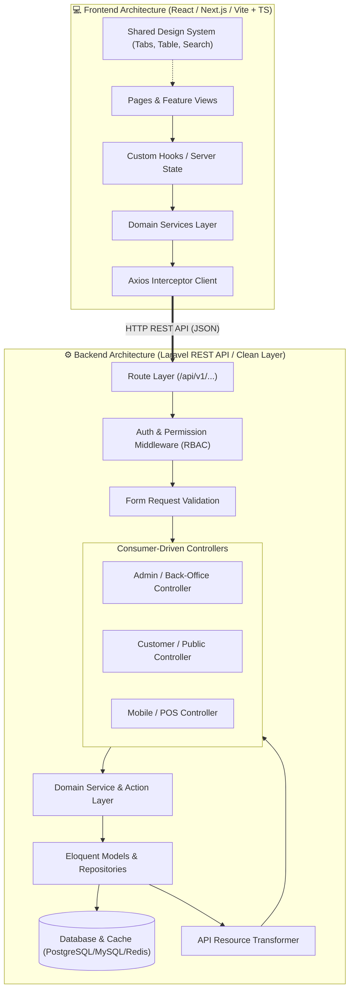

# 🏛️ Enterprise Full-Stack Architecture Blueprint
> **គំរូស្ថាបត្យកម្ម Backend & Frontend កម្រិត Enterprise (ស្របតាម KHPosCommerce Monorepo)**  
> **គោលបំណង:** ងាយស្រួលយល់ និងអាចយកទៅចម្លងអនុវត្ត (Apply) លើគម្រោងថ្មីៗបានយ៉ាងឆាប់រហ័ស (ERP, CRM, Hospital/Clinic, School System, Booking, E-Commerce, SaaS)។

---

គំនិតស្ថាបត្យកម្ម (Architecture & Folder Structure) ដែលប្រើប្រាស់នៅក្នុងគម្រោង **KHPosCommerce** នេះ គឺជាទម្រង់ **Enterprise-grade Clean Architecture** ដែលបែងចែកការទទួលខុសត្រូវដាច់ពីគ្នា (Separation of Concerns) យ៉ាងច្បាស់លាស់។

ទម្រង់នេះងាយស្រួលយកទៅ **Apply លើគ្រប់គម្រោង** (ដូចជា ERP, CRM, Hospital/School System, Booking System ឬ E-Commerce) ដោយសារវាអាចពង្រីកបានធំ (Scalable), ងាយស្រួលថែទាំ (Maintainable) និងកូដមានភាពស្អាតជានិច្ច។

---

## 🏛️ ១. គំនិតស្នូល (Core Philosophy & Architecture Overview)

ប្រព័ន្ធទាំងមូលដើរលើគោលការណ៍ **Client-Segregated APIs** និង **Feature-Driven / Layered Frontend**៖
- **Backend**: ប្រើ **Consumer-Driven Layered Pattern** ដោយបំបែក Controller តាម Channel អ្នកប្រើប្រាស់ (Admin, Customer, Mobile) រីឯ Business Logic ទាំងអស់ស្ថិតនៅក្នុង `Services` ឬ `Actions` ដើម្បីកុំឱ្យស្ទួនកូដ។
- **Frontend**: ប្រើ **Layered + Feature-Driven Architecture** ដោយបំបែក API Service ដាច់ចេញពី UI State និងមាន Shared Design System ដែលអាចប្រើឡើងវិញបានទូទាំងប្រព័ន្ធ។



---

## 📁 ២. ទម្រង់ Folder Structure សម្រាប់ Backend (Laravel / Clean Architecture)

គំរូនេះប្រើ **Consumer-Driven Layered Pattern**៖ Controllers ត្រូវបំបែកតាម Channel អ្នកប្រើប្រាស់ (Admin, Customer, Mobile) រីឯ Business Logic ទាំងអស់ស្ថិតនៅក្នុង Services ឬ Actions ដើម្បីកុំឱ្យជាន់គ្នា។

```text
backend/
├── app/
│   ├── Http/
│   │   ├── Controllers/
│   │   │   └── Api/
│   │   │       ├── BaseApiController.php    # 🌟 Class មេ គ្រប់គ្រង Standard JSON Response
│   │   │       ├── Traits/                  # Reusable Controller Traits (HasBulkActions, HasTrashActions)
│   │   │       └── V1/
│   │   │           ├── Auth/                # Login, Register, Profile, OTP
│   │   │           ├── Admin/               # 👑 សម្រាប់ Back-Office ERP (Full CRUD, Audit, RBAC)
│   │   │           │   ├── Product/
│   │   │           │   ├── Order/
│   │   │           │   └── User/
│   │   │           ├── Customer/            # 🛒 សម្រាប់ E-Commerce Storefront (Public, Caching, Slugs)
│   │   │           └── Mobile/              # 📱 សម្រាប់ Mobile App / POS (Lightweight, Offline sync)
│   │   ├── Middleware/                      # MultiTenant, RBAC, Language detector
│   │   ├── Requests/                        # 🛡️ Form Requests (Validate Input មុនចូល Controller)
│   │   │   └── [Domain]/                    # e.g., StoreProductRequest.php, UpdateProductRequest.php
│   │   └── Resources/                       # 🔄 API Resources (Transform Model ទៅជា Clean JSON Response)
│   │       └── [Domain]/                    # e.g., ProductResource.php, ProductCollection.php
│   │
│   ├── Services/                            # 🧠 Business Logic (Transactions, Stock, Payments)
│   │   ├── ProductService.php
│   │   └── OrderService.php
│   ├── Actions/                             # Single-purpose Action Classes (e.g., CreateInvoiceAction)
│   ├── Models/                              # Eloquent Entities & Relationships
│   ├── Enums/                               # PHP 8.1+ Enums (OrderStatus, PaymentMethod, Role)
│   ├── Events/ & Listeners/                 # Asynchronous Events (SendNotification, AuditLog)
│   └── Jobs/                                # Background Queues (Email, Report Export)
│
├── routes/
│   ├── api.php
│   └── api/
│       └── v1/                              # បំបែក Routes តាម Channel
│           ├── admin.php                    # /api/v1/admin/*
│           ├── customer.php                 # /api/v1/customer/*
│           ├── mobile.php                   # /api/v1/mobile/*
│           └── auth.php                     # /api/v1/auth/*
```

---

## 💻 ៣. ទម្រង់ Folder Structure សម្រាប់ Frontend (React / Vite / Next.js)

រចនាសម្ព័ន្ធ Frontend ប្រើ **Feature-Driven + Layered Architecture** ដែលបំបែក API Service ចេញពី UI និងចែក Feature ច្បាស់ៗ។

```text
frontend/src/
├── api/
│   └── client.ts             # 🌟 Axios Instance កណ្តាល (Bearer Token, ស្ទាក់ Error, Toast បកប្រែ ២ ភាសា)
│
├── components/
│   ├── common/               # UI តូចៗ: Button, Input, Badge, Spinner, Modal
│   ├── layout/               # MainLayout, Sidebar, Header, NotificationCenter
│   └── shared/               # 🌟 Reusable Enterprise Components (ប្រើគ្រប់ Module):
│       ├── WorkspaceTabs.tsx         # Tab ផ្ទេរទំព័រ ឬ Sub-modules
│       ├── SearchInput.tsx           # Search bar ដែលមាន Clear button (h-10)
│       ├── ResetButton.tsx           # ប៊ូតុង Reset filters
│       ├── TableWrapper.tsx          # Table skeleton, Loading, Empty state
│       ├── Pagination.tsx            # Pagination បែប Server-side
│       ├── ColumnSettingsPopover.tsx # ជ្រើសរើស Show/Hide Table Column (save ក្នុង LocalStorage)
│       └── FilterDrawerShell.tsx     # Slide-over filter drawer ពីចំហៀង
│
├── hooks/                    # Reusable Hooks (useAuth, useServerPagination, useDebounce)
├── locales/                  # Dictionaries ភាសា (km.json, en.json) ប្រើជាមួយ i18next
├── stores/                   # Global Client State (Zustand: authStore, themeStore, cartStore)
├── services/                 # 🌐 API Calling Functions (បំបែកតាម Domain)
│   ├── productService.ts
│   ├── orderService.ts
│   └── customerService.ts
│
├── types/                    # TypeScript Interfaces & Types
│   ├── api.ts                # ApiResponse<T>, PaginatedResponse<T>
│   └── [domain].ts           # Product, Order, Customer types
│
└── pages/ (ឬ features/)      # 📦 ផ្ដុំ Page តាម Domain Feature
    ├── dashboard/
    ├── products/
    │   ├── ProductList.tsx
    │   ├── ProductFormModal.tsx
    │   └── ProductFilterDrawer.tsx
    ├── orders/
    └── settings/
```

---

## 📑 ៤. កូដគំរូស្ដង់ដារ (Standard Boilerplate Snippets)

### ១. Backend: Standard API Controller & Response Pattern

```php
// app/Http/Controllers/Api/V1/Admin/Product/BrandController.php
namespace App\Http\Controllers\Api\V1\Admin\Product;

use App\Http\Controllers\Api\BaseApiController;
use App\Http\Requests\Product\StoreBrandRequest;
use App\Models\Brand;
use App\Services\BrandService;
use Illuminate\Http\JsonResponse;
use Illuminate\Http\Request;

class BrandController extends BaseApiController
{
    public function __construct(protected BrandService $brandService) {}

    // GET: /api/v1/admin/brands?search=...&page=1
    public function index(Request $request): JsonResponse
    {
        $data = $this->brandService->paginate($request->all());
        return $this->paginatedResponse($data); // ផ្ញើចេញ standard format ជាមួយ pagination
    }

    // POST: /api/v1/admin/brands
    public function store(StoreBrandRequest $request): JsonResponse
    {
        $brand = $this->brandService->create($request->validated());
        return $this->successResponse($brand, 'Brand created successfully', 201);
    }
}
```

Format Output JSON ដែលត្រលប់មកវិញមានទម្រង់មួយស្ដង់ដារជានិច្ច៖

```json
{
  "success": true,
  "message": "Success",
  "data": [...],
  "pagination": {
    "total": 120,
    "per_page": 10,
    "current_page": 1,
    "last_page": 12,
    "from": 1,
    "to": 10
  }
}
```

---

### ២. Frontend: Service Layer Pattern

បង្កើត Service សុទ្ធសាធ គ្មាន UI logic នៅខាងក្នុង៖

```typescript
// src/services/brandService.ts
import api from '@/api/client'
import type { Brand, PaginatedResponse, ApiResponse } from '@/types'

export const brandService = {
  list: (params: Record<string, any> = {}) =>
    api.get<PaginatedResponse<Brand>>('/admin/brands', { params }).then(res => res.data),

  show: (id: number) =>
    api.get<ApiResponse<Brand>>(`/admin/brands/${id}`).then(res => res.data.data),

  create: (data: Partial<Brand> | FormData) =>
    api.post<ApiResponse<Brand>>('/admin/brands', data).then(res => res.data.data),

  update: (id: number, data: Partial<Brand> | FormData) =>
    api.put<ApiResponse<Brand>>(`/admin/brands/${id}`, data).then(res => res.data.data),

  delete: (id: number) =>
    api.delete<ApiResponse<void>>(`/admin/brands/${id}`).then(res => res.data),

  bulkDelete: (ids: number[]) =>
    api.post<ApiResponse<void>>('/admin/brands/bulk-delete', { ids }).then(res => res.data),
}

export default brandService
```

---

### ៣. Frontend: Standard Page Component Layout

រៀបចំ UI ឱ្យមានរបៀបរៀបរយស្មើគ្នាគ្រប់ Module៖

```tsx
// src/pages/brands/BrandList.tsx
import { useState, useEffect } from 'react'
import { brandService } from '@/services/brandService'
import WorkspaceTabs from '@/components/shared/WorkspaceTabs'
import SearchInput from '@/components/shared/SearchInput'
import ResetButton from '@/components/shared/ResetButton'
import TableWrapper from '@/components/shared/TableWrapper'
import Pagination from '@/components/shared/Pagination'

export default function BrandList() {
  const [data, setData] = useState([])
  const [search, setSearch] = useState('')
  const [page, setPage] = useState(1)
  const [loading, setLoading] = useState(false)
  const [pagination, setPagination] = useState({ total: 0, last_page: 1 })

  // Data fetching logic (ឬអាចជំនួសដោយ TanStack Query)
  useEffect(() => {
    fetchBrands()
  }, [page, search])

  const fetchBrands = async () => {
    setLoading(true)
    try {
      const res = await brandService.list({ page, search })
      setData(res.data)
      setPagination(res.pagination)
    } finally {
      setLoading(false)
    }
  }

  return (
    <div className="space-y-4 p-6">
      {/* 1. Header & Reusable Tabs */}
      <WorkspaceTabs
        tabs={[
          { id: 'all', label: 'All Brands', count: pagination.total },
          { id: 'archived', label: 'Trash' },
        ]}
        activeTab="all"
        onChange={() => {}}
      />

      {/* 2. Standard Search & Filter Row */}
      <div className="flex items-center justify-between gap-3">
        <div className="flex items-center gap-2">
          <SearchInput value={search} onChange={setSearch} placeholder="Search brand..." />
          <ResetButton onClick={() => { setSearch(''); setPage(1); }} />
        </div>
        <button className="h-10 px-4 rounded-xl bg-primary text-white font-medium">
          + Add New
        </button>
      </div>

      {/* 3. Standard Table Wrapper with Loading Skeleton */}
      <TableWrapper loading={loading} isEmpty={data.length === 0}>
        <table className="w-full text-left">
          {/* Table headers & rows */}
        </table>
      </TableWrapper>

      {/* 4. Unified Server-side Pagination */}
      <Pagination
        currentPage={page}
        lastPage={pagination.last_page}
        onPageChange={setPage}
      />
    </div>
  )
}
```

---

## 🚀 ៥. ជំហានយកទៅ Apply លើ Project ថ្មី (5-Step Implementation Checklist)

ពេលចាប់ផ្ដើម Project ថ្មី (ឧទាហរណ៍៖ **Clinic / Hospital Management System**)៖

- **Backend Step 1 (Database & Models)**:
  - បង្កើត Migration, Eloquent Model និង Enums (ឧ. `Patient.php`, `Appointment.php`, `AppointmentStatus::PENDING`)។
- **Backend Step 2 (Form Request & Resource)**:
  - បង្កើត `StorePatientRequest.php` ដើម្បី Validate ទិន្នន័យ។
  - បង្កើត `PatientResource.php` ដើម្បីកំណត់ទិន្នន័យ Output មិនឱ្យបែកធ្លាយទិន្នន័យសម្ងាត់។
- **Backend Step 3 (Service & Controller)**:
  - សរសេរ Logic ក្នុង `PatientService.php` (Save DB, Send SMS Reminder)។
  - Controller ហៅ `PatientService` រួច return `$this->paginatedResponse(...)` ឬ `$this->successResponse(...)`។
- **Frontend Step 1 (API Service & Types)**:
  - បង្កើត Interface `Patient` ក្នុង `types/patient.ts`។
  - បង្កើត `patientService.ts` ជាមួយ `list`, `show`, `create`, `update`, `delete`។
- **Frontend Step 2 (Page Assembly)**:
  - បង្កើត `PatientList.tsx` ដោយផ្គុំ Shared Components ដែលមានស្រាប់ (`WorkspaceTabs`, `SearchInput`, `TableWrapper`, `Pagination`) នោះអ្នកនឹងទទួលបានទំព័រដែលមាន UI/UX ស្អាតស្ដង់ដារ Enterprise ភ្លាមៗដោយមិនបាច់សរសេរឡើងវិញពីសូន្យ។
